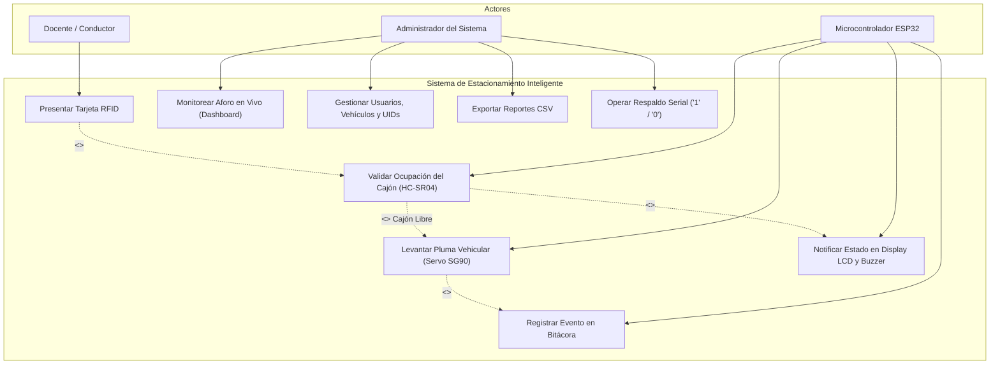
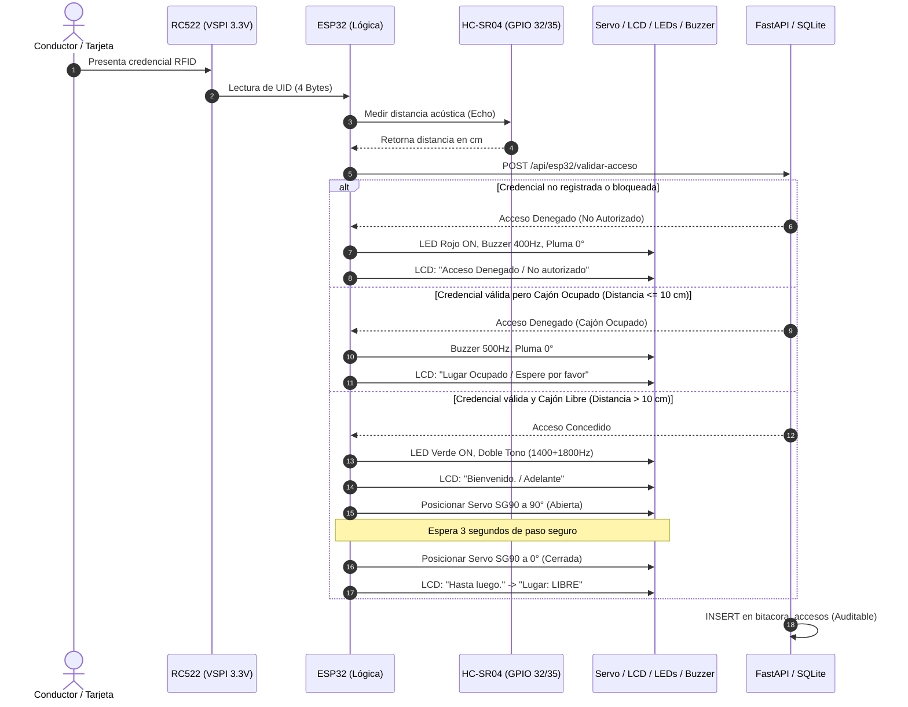

# DOCUMENTO TÉCNICO DE ARQUITECTURA Y PROYECTO FINAL
## TECNOLOGÍAS COMPUTACIONALES II — UAEMÉX
### Sistema Automatizado e Inteligente de Control de Acceso y Gestión de Aforo Vehicular mediante ESP32, RFID y Arquitectura IoT Cliente-Servidor

---

## 1. Título del Proyecto (1 Pts)
**"Sistema Inteligente de Control de Acceso Vehicular y Monitoreo de Aforo en Tiempo Real con ESP32, Identificación RFID por Bus VSPI y Plataforma Web Híbrida IoT"**

*Razón de ser del título:* Es conciso, profesional y refleja la naturaleza innovadora y de integración de hardware embebido (ESP32 WROOM-32D Core 3.x), sensórica física (HC-SR04 y RC522) y servicios cliente-servidor en tiempo real.

---

## 2. Descripción del Problema y Justificación Técnica (3 Pts)

### 2.1 Contexto Institucional y Problemática de Origen
En los campus universitarios, las áreas de estacionamiento asignadas a profesores de tiempo completo, investigadores y personal administrativo enfrentan severos problemas de control operativo:
1. **Ingreso no regulado de vehículos no autorizados:** Al carecer de filtrado estricto o depender de vigilancias humanas vulnerables a distracciones, vehículos de alumnos o personal ajeno saturan los cajones reservados.
2. **Falta de trazabilidad y seguridad:** No existe una bitácora digital que registre la hora de entrada/salida, las placas del vehículo, la identidad del docente y los intentos de acceso no autorizados.
3. **Pérdida de tiempo y congestión interna:** Los conductores ingresan al estacionamiento sin saber si hay cajones disponibles, circulando en vano y generando emisiones contaminantes y cuellos de botella en los accesos.
4. **Carencia de sincronización centralizada:** Los sistemas mecánicos tradicionales o las plumas con tarjetas autónomas no informan a una plataforma web institucional sobre la disponibilidad en vivo ni permiten gestionar bajas inmediatas de credenciales perdidas.

### 2.2 Justificación de la Solución de Hardware y Software
Se implementa una solución de ingeniería mecatrónica e informática integral que acopla:
- Un **controlador de borde (Edge Computing) basado en ESP32 WROOM-32D**: Gestiona directamente los actuadores mecánicos (servomotor de pluma SG90), señales acústicas (buzzer LEDC), indicadores lumínicos (LEDs bicolor) e interfaces visuales locales (display LCD 16x2 por I2C), garantizando una latencia de respuesta inferior a 150 ms para el conductor.
- **Sensórica dual de validación:** Un lector **RFID RC522 (13.56 MHz)** por bus nativo VSPI para identificación unívoca y un sensor de presencia ultrasónico **HC-SR04** que mide la presencia física en el cajón con un umbral estricto ($\le 10\text{ cm}$).
- **Capa de Software en Tiempo Real:** Un servidor backend con **FastAPI**, persistencia en **SQLite** y un **Dashboard Web / App Móvil PWA** con gemelo digital del hardware que permite a la administración monitorear el aforo, registrar altas de vehículos/placas y auditar accesos en tiempo real.

---

## 3. Objetivos Principales (3 Pts)

### 3.1 Objetivo General
Diseñar, construir e implementar un prototipo físico y plataforma de software para el control automatizado de acceso vehicular y monitoreo de disponibilidad en tiempo real, mediante un microcontrolador ESP32 acoplado a un lector RFID, sensor ultrasónico de cajón y una arquitectura web cliente-servidor con base de datos relacional para el estacionamiento docente.

### 3.2 Objetivos Específicos
1. **Desarrollar el subsistema de hardware y control de acceso local (Qué):** Integrar en un microcontrolador ESP32 WROOM-32D el sensor ultrasónico HC-SR04, servomotor SG90 (con alimentación externa de 6V), buzzer con tono LEDC, display LCD 16x2 I2C y módulo RFID RC522 en bus VSPI (3.3V) **(Cómo)** mediante firmware en C++ con lógica condicional de seguridad **(Para qué)** para bloquear el paso si el cajón está ocupado o la credencial no está autorizada, y habilitar la apertura por 3 segundos en accesos legítimos.
2. **Implementar la capa de software y persistencia de datos (Qué):** Diseñar un backend en Python con FastAPI y SQLite **(Cómo)** a través de una API REST que exponga endpoints de validación, telemetría y CRUD de usuarios/vehículos **(Para qué)** para centralizar el padrón vehicular y resguardar la bitácora auditable de eventos.
3. **Desplegar una interfaz responsiva y gemelo digital en tiempo real (Qué):** Construir un Dashboard Web con soporte PWA **(Cómo)** utilizando HTML5, Tailwind CSS y Web Audio API con refresco reactivo **(Para qué)** para permitir el monitoreo remoto del aforo, el control manual de la barrera y la administración de credenciales desde cualquier dispositivo móvil o de escritorio.

---

## 4. Requerimientos del Sistema (4 Pts)

### 4.1 Requerimientos Funcionales (RF)
- **RF-01 (Identificación RFID):** El sistema debe capturar el UID (4 bytes) de tarjetas o llaveros MIFARE a 13.56 MHz a una distancia de 1 a 3 cm.
- **RF-02 (Modo de Respaldo Serial):** El firmware debe permitir la validación manual por consola Serial (`'1'` para autorizar, `'0'` para denegar) en ausencia del lector físico.
- **RF-03 (Detección de Ocupación por Ultrasonido):** El sensor HC-SR04 debe medir la distancia del cajón cada 500 ms y clasificar el estado como `OCUPADO` si la distancia es $\le 10\text{ cm}$ o `LIBRE` si es mayor.
- **RF-04 (Bloqueo por Cajón Lleno):** Si una credencial autorizada se presenta pero el sensor detecta el cajón ocupado, el sistema debe denegar el acceso, mantener la pluma a 0°, mostrar en el LCD *"Lugar Ocupado / Espere por favor"* y sonar el buzzer a 500 Hz.
- **RF-05 (Apertura Automatizada de Pluma):** Ante una credencial válida con cajón libre, el servo debe elevar la pluma a 90°, encender el LED verde, emitir doble tono de bienvenida (1400 Hz y 1800 Hz), mantener abierta la pluma por 3 segundos y retornarla a 0°.
- **RF-06 (Rechazo de Credenciales No Autorizadas):** Ante UIDs no registrados o en estado bloqueado, el sistema debe mantener la pluma en 0°, encender el LED rojo, emitir tono de alerta (400 Hz por 700 ms) y mostrar *"Acceso Denegado"*.
- **RF-07 (Gestión de Padrón Vehicular):** La plataforma web debe permitir el alta, edición, bloqueo y eliminación de usuarios, asociando su nombre, rol, departamento, placas, marca, modelo, color y UID RFID.
- **RF-08 (Auditoría y Exportación):** El sistema debe registrar en base de datos cada intento de acceso con marca de tiempo, resultado, distancia del sensor y motivo, y permitir exportar el historial en formato CSV compatible con Microsoft Excel.

### 4.2 Requerimientos No Funcionales (RNF)
- **RNF-01 (Latencia de Decisión Local):** El tiempo entre la presentación del tag RFID y la activación de los actuadores (servo/LEDs) no debe exceder los 200 ms en modo local y 500 ms en modo API Wi-Fi.
- **RNF-02 (Estabilidad Eléctrica y Prevención de Brownouts):** El servomotor SG90 debe alimentarse de una fuente externa de 6V DC (4 pilas AA) con masa (GND) compartida con el ESP32, impidiendo caídas de tensión por picos de corriente inductiva.
- **RNF-03 (Tolerancia a Fallos de Red / Modo Híbrido):** Si la conexión Wi-Fi se interrumpe, el ESP32 debe continuar operando con su caché local de UIDs autorizados almacenada en memoria interna.
- **RNF-04 (Integridad Eléctrica del Módulo RFID):** El bus SPI y la línea VCC del módulo RC522 deben operar exclusivamente a 3.3V, respetando la tensión nominal de las líneas lógicas del microcontrolador.
- **RNF-05 (Diseño Responsivo e Instalabilidad PWA):** La interfaz web debe adaptarse fluidamente a pantallas de escritorio y teléfonos inteligentes mediante viewport responsivo y manifiesto PWA (`manifest.json`).

---

## 5. Paradigmas de Uso y Modelos de Interacción (2 Pts)

### 5.1 Paradigma IoT (Internet de las Cosas) y Edge Computing
El sistema aplica el paradigma de computación en el borde (*Edge Computing*): el microcontrolador ESP32 procesa localmente y a alta velocidad las señales analógicas y de modulación de ancho de pulso (PWM/LEDC), al tiempo que actúa como un nodo IoT que sincroniza telemetría hacia la nube o servidor local mediante protocolos estándar de la capa de aplicación (HTTP/REST y JSON).

### 5.2 Paradigma Orientado a Eventos (Event-Driven)
El firmware del microcontrolador y el frontend web se estructuran bajo una arquitectura reactiva basada en eventos:
- *Evento de Hardware:* Llegada de una tarjeta al campo electromagnético del RC522 (`PICC_IsNewCardPresent`) o cambio de umbral acústico en el HC-SR04 desencadena la rutina de interrupción de estado.
- *Evento de Software:* Una petición POST desde el puente serial o la app móvil desencadena el cambio de variable y el refresco en el gemelo digital.

### 5.3 Paradigma Cliente-Servidor REST
La comunicación entre la maqueta física y el sistema de administración se desacopla mediante servicios RESTful sin estado (*stateless*):
- **Cliente:** Microcontrolador ESP32 (mediante `HTTPClient` de C++) y navegador web móvil (mediante `fetch` asíncrono).
- **Servidor:** API en FastAPI (Python) que gestiona las reglas de negocio y persiste en SQLite.

---

## 6. Casos de Uso y Diagrama de Procesos (UML) (4 Pts)

### 6.1 Diagrama de Casos de Uso (Mermaid UML)


### 6.2 Diagrama de Secuencia y Proceso de Decisión


---

## 7. Tipos de Datos a Ocupar (2 Pts)

### 7.1 Tipos de Datos en Firmware C++ (ESP32)
| Variable / Estructura | Tipo de Dato C++ | Descripción / Rango |
|---|---|---|
| `SS_PIN`, `TRIG_PIN`, etc. | `#define` / `uint8_t` | Identificadores de pines GPIO del microcontrolador (0–39). |
| `UIDS_AUTORIZADOS[][4]` | Matriz de `byte` (`uint8_t`) | Almacena los 4 bytes de cada tarjeta MIFARE (ej. `{0x83, 0xCF, 0x7A, 0x28}`). |
| `lugarOcupado` | `bool` | Indicador booleano de presencia física (`true` / `false`). |
| `distanciaActualCm` | `long` | Distancia calculada en centímetros: $\text{duración} / 58$. |
| `ultimaLecturaUltrasonico`| `unsigned long` | Marca de tiempo en milisegundos (`millis()`) para muestreo no bloqueante. |
| `pulsoUs` | `int` | Ancho de pulso en microsegundos (544 $\mu\text{s}$ a 2400 $\mu\text{s}$) para control del servo. |

### 7.2 Tipos de Datos en Capa Web (Python Pydantic & JSON)
| Parámetro | Tipo Python | Esquema JSON | Ejemplo |
|---|---|---|---|
| `uid` | `str` | `"string"` | `"83 CF 7A 28"` |
| `distancia_cm` | `float` | `"number"` | `6.5` |
| `acceso_concedido` | `bool` | `"boolean"` | `true` |
| `angulo_servo` | `int` | `"integer"` | `90` |
| `buzzer_tonos` | `List[Dict[str, int]]`| `"array[object]"` | `[{"freq": 1400, "ms": 120}, ...]` |

### 7.3 Esquema Relacional de Base de Datos (SQLite)
- `usuarios`: `id (INTEGER PK)`, `nombre (TEXT)`, `rol (TEXT)`, `departamento (TEXT)`, `correo (TEXT)`, `activo (INTEGER)`, `fecha_registro (TEXT)`.
- `vehiculos`: `id (INTEGER PK)`, `usuario_id (INTEGER FK)`, `placas (TEXT UNIQUE)`, `marca (TEXT)`, `modelo (TEXT)`, `color (TEXT)`.
- `credenciales_rfid`: `id (INTEGER PK)`, `uid (TEXT UNIQUE)`, `usuario_id (INTEGER FK)`, `estado (TEXT)`, `fecha_asignacion (TEXT)`.
- `cajones`: `codigo (TEXT PK)`, `estado (TEXT)`, `distancia_cm (REAL)`, `umbral_cm (REAL)`, `es_sensor_fisico (INTEGER)`.
- `bitacora_accesos`: `id (INTEGER PK)`, `timestamp (TEXT)`, `uid_leido (TEXT)`, `tipo_evento (TEXT)`, `acceso_concedido (INTEGER)`, `motivo (TEXT)`.

---

## 8. Justificación Técnica de Sensores y Placa Microcontroladora (4 Pts)

### 8.1 Comparativa y Elección del Microcontrolador (ESP32 vs Alternativas)
| Parámetro Técnico | Arduino Uno R3 | Arduino Mega 2560 | ESP8266 (NodeMCU) | **ESP32 WROOM-32D (Seleccionado)** |
|---|---|---|---|---|
| **Arquitectura** | AVR 8-bit (16 MHz) | AVR 8-bit (16 MHz) | Tensilica 32-bit (80 MHz)| **Dual-Core Xtensa 32-bit (240 MHz)** |
| **Memoria SRAM** | 2 KB | 8 KB | 80 KB | **520 KB SRAM (Apta para JSON/HTTP)** |
| **Memoria Flash** | 32 KB | 256 KB | 4 MB | **4 MB Flash** |
| **Conectividad** | Nula (Requiere shields)| Nula (Requiere shields)| Wi-Fi 2.4 GHz | **Wi-Fi 802.11 b/g/n + BLE 4.2 integrado** |
| **Canales PWM/LEDC** | 6 canales básicos | 15 canales | 4 canales | **16 canales LEDC de alta precisión asignables** |
| **Buses SPI/I2C** | 1 SPI, 1 I2C | 1 SPI, 1 I2C | 1 SPI, 1 I2C | **2 SPI nativos (VSPI/HSPI) + 2 I2C independientes** |
| **Nivel Lógico** | 5V | 5V | 3.3V | **3.3V Nativo (Compatible directo con RC522)** |

*Justificación Técnica:* Se seleccionó el **ESP32 WROOM-32D** debido a su procesador de doble núcleo (permite ejecutar la lógica de control crítico y actuadores en un núcleo mientras atiende las peticiones HTTP/Wi-Fi en el otro), su soporte nativo para periféricos I2C y VSPI simultáneos, y su compatibilidad directa con el nivel lógico de 3.3V del RC522 sin riesgo de sobretensión.

### 8.2 Justificación de Sensores y Actuadores
- **Lector RFID RC522 (VSPI 3.3V):** Protocolo ISO/IEC 14443A (13.56 MHz), altamente comercial, bajo consumo y con interfaz SPI de alta tasa de transferencia (hasta 10 Mbps).
- **Sensor Ultrasónico HC-SR04:** Rango de 2 cm a 400 cm con resolución de 3 mm; ideal para la detección frontal o aérea del chasis del vehículo en el cajón físico.
- **Servomotor SG90:** Torque de 1.8 kg·cm a 4.8V–6V con ángulo de 0° a 180°, perfecto para elevar la pluma de la maqueta sin sobrecalentamiento.
- **Display LCD 16x2 con Mochila I2C (PCF8574):** Reduce el cableado de 16 hilos a solo 2 líneas de comunicación (SDA GPIO 21 y SCL GPIO 22).

---

## 9. Material para la Maqueta Física (1 Pts)

La maqueta a escala reproduce el carril de entrada y un cajón de estacionamiento universitario:
- **Estructura Base:** Tabla de MDF de 6 mm (45 cm $\times$ 35 cm) recubierta con vinilo mate negro simulando el pavimento y líneas viales amarillas reglamentarias.
- **Caseta y Poste de Pluma:** Caja de corte láser de acrílico cristal de 3 mm y torre de soporte en acrílico blanco para montaje rígido del servomotor SG90.
- **Brazo de la Pluma:** Brazo ligero de estireno/balsa de 18 cm con franjas diagonales reflectivas rojas y blancas.
- **Soporte del Sensor Ultrasónico:** Base cenital a 12 cm de altura sobre el cajón A-01 para enfocar el haz acústico perpendicularmente al capacete del vehículo a escala.
- **Cableado e Interconexión:** Jumpers Dupont tipo dupont M-H y H-H calibre 24 AWG trenzados y organizados con termofit para evitar falsos contactos mecánicos.

---

## 10. Presupuesto Desglosado de Materiales (1 Pts)

| Ítem | Componente / Material | Cantidad | Proveedor Real | Costo Unitario (MXN) | Costo Total (MXN) |
|:---:|---|:---:|---|:---:|:---:|
| 1 | Microcontrolador ESP32 WROOM-32D (38 pines) | 1 | AG Electrónica | \$145.00 | \$145.00 |
| 2 | Módulo RFID RC522 con tarjeta y tag llavero (3.3V) | 1 | Steren / AG Electrónica | \$68.00 | \$68.00 |
| 3 | Sensor Ultrasónico HC-SR04 | 1 | Steren | \$52.00 | \$52.00 |
| 4 | Display LCD 16x2 Azul con Módulo I2C PCF8574 | 1 | AG Electrónica | \$95.00 | \$95.00 |
| 5 | Micro Servomotor TowerPro SG90 (9g) | 1 | AG Electrónica | \$48.00 | \$48.00 |
| 6 | Buzzer Activo 5V / Pasivo LEDC | 1 | Steren | \$18.00 | \$18.00 |
| 7 | LEDs difusos 5mm (1 Verde, 1 Rojo) y resistores 220Ω | 1 kit | AG Electrónica | \$15.00 | \$15.00 |
| 8 | Portapilas 4xAA con switch (6V para Servo) | 1 | Steren | \$32.00 | \$32.00 |
| 9 | Pilas Alcalinas AA (Paquete 4 piezas) | 1 | Walmart | \$65.00 | \$65.00 |
| 10 | Protoboard 830 puntos transparente | 1 | Steren | \$89.00 | \$89.00 |
| 11 | Jumpers Dupont surtidos (M-M, M-H, H-H) 40 piezas | 1 | AG Electrónica | \$45.00 | \$45.00 |
| 12 | Base MDF 6mm, corte acrílico y tornillería | 1 | Maderería / Home Depot | \$120.00 | \$120.00 |
| **—** | **Subtotal de Materiales** | | | | **\$792.00** |
| **—** | **Margen de Contingencia / Gastos de Envío (15%)** | | | | **\$118.80** |
| **—** | **PRESUPUESTO TOTAL GENERAL** | | | | **\$910.80 MXN** |

---

## 11. Prototipo de Interfaz y Wireframes (UI/UX) (5 Pts)

La solución cuenta con un panel responsive (diseñado con filosofía *Mobile-First* y disponible tanto en modo Centro de Control como en modo App Móvil PWA):

### 11.1 Wireframe: Dashboard Principal y Gemelo Digital del Hardware
```text
+---------------------------------------------------------------------------------------------------+
|  [P] Estacionamiento Inteligente ESP32 - UAEMEX          [API: Conectada] [Buzzer: ON] [📱 Móvil] |
|  Pestañas: [📡 Monitoreo en Vivo]  [🪪 Gestión Usuarios]  [📋 Bitácora]  [🔌 Pinout Hardware]     |
+---------------------------------------------------------------------------------------------------+
|  DISPONIBLES: 3/4 (75% Libre) | CAJÓN A-01: LIBRE (42.0 cm) | PLUMA: CERRADA (0°) | UIDs: 4 Activos|
+---------------------------------------------------------------------------------------------------+
|  COLUMNA 1: GEMELO DIGITAL DEL ESP32 (7 Cols)      | COLUMNA 2: SIMULADOR RFID Y SERIAL (5 Cols)   |
|  +-----------------------------------------------+ | +-------------------------------------------+ |
|  | DISPLAY LCD 16x2 I2C (SDA:21 | SCL:22)        | | | ⚡ MODO RESPALDO CONSOLA SERIAL (115200)   | |
|  | +-------------------------------------------+ | | | [ ✅ Enviar '1' (Autorizar) ]             | |
|  | | Lugar: LIBRE                              | | | | [ ⛔ Enviar '0' (Denegar)   ]             | |
|  | | Acerque tarjeta                           | | | +-------------------------------------------+ |
|  | +-------------------------------------------+ | |                                             |
|  | [LED Verde: OFF] [LED Rojo: OFF] [Buzzer: 🔔] | | TARJETAS RÁPIDAS AL LECTOR RC522 (VSPI 3.3V): |
|  +-----------------------------------------------+ | [💳 83 CF 7A 28 | Mtro. Carlos Solano      ] |
|  | BARRERA SERVO SG90       | SENSOR HC-SR04     | | [💳 A3 6C 9F 14 | Dra. Diana Ivon Benítez  ] |
|  | [Animación Brazo 0°/90°] | Slider: [==|====]  | | [💳 FF 99 A2 04 | Tarjeta Desconocida (Probar)] |
|  | [⬆️ Subir Pluma]         | Valor: 42.0 cm     | |                                             |
|  | [⬇️ Bajar Pluma]         | [🚗 Ocupar] [🟢Libre| | MONITOR SERIAL EN VIVO (>_ 115200 baudios): |
|  +-----------------------------------------------+ | +-------------------------------------------+ |
|  MAPA DE CAJONES:                                  | | [21:28:10] HC-SR04: 42.0 cm | ESTADO: LIBRE| |
|  [A-01: LIBRE (Físico)]   [A-02: OCUPADO]          | | [21:28:12] Listo para tarjetas o Serial...| |
|  [A-03: LIBRE]            [A-04: LIBRE]            | +-------------------------------------------+ |
+----------------------------------------------------+----------------------------------------------+
```

### 11.2 Wireframe: Módulo de Padrón y Bitácora Auditable
- **Formulario de Registro Rápido:** Permite registrar con un solo clic el nombre del docente, su rol académico, placas vehiculares, marca/modelo y asignar el UID RFID (incluyendo generador aleatorio de 4 bytes o lectura automática).
- **Tabla de Gestión Dinámica:** Permite conmutar al instante el estado de cualquier tarjeta entre `ACTIVA` y `BLOQUEADA` (por reporte de robo o pérdida de credencial), impidiendo el acceso en tiempo real.
- **Bitácora Auditable:** Vista tabular con badges de estado (`✅ CONCEDIDO`, `🚗 SALIDA`, `⚠️ CAJÓN OCUPADO`, `⛔ DENEGADO`), marca de tiempo milimétrica, lectura ultrasónica en el instante del cruce y botón de exportación directa a formato CSV para Excel.

---

## 12. Anexo: Prompt de Ingeniería Utilizado para el Diseño del Sistema

A continuación se documenta el **Prompt Maestro de Ingeniería** empleado para estructurar y desarrollar de forma integral el firmware del ESP32, la base de datos SQLite, la API REST en FastAPI y la plataforma Web/Móvil con Gemelo Digital:

```text
Actúa como un Ingeniero Senior en Sistemas Embebidos IoT y Desarrollador Full-Stack. Necesito diseñar, programar e integrar la capa completa de firmware, base de datos, backend API REST y plataforma web/móvil para un "Sistema de Estacionamiento Inteligente Universitario basado en ESP32", alineado con una arquitectura física real en maqueta.

1. ESPECIFICACIÓN Y MAPEO DE HARDWARE (ESP32 DOIT DEVKIT V1 - 30 PINES):
- Lector RFID RC522 (alimentado estrictamente a 3.3V y GND directo al ESP32) en el bus VSPI nativo:
  SDA (SS): GPIO 5 | SCK: GPIO 18 | MISO: GPIO 19 | MOSI: GPIO 23 | RST: GPIO 27 (con ganancia máxima RxGain_max y rearme automático de antena).
- Sensor Ultrasónico HC-SR04 #1 (Ocupación del Cajón A-01):
  TRIG: GPIO 32 | ECHO: GPIO 35 | Umbral: <= 10 cm = OCUPADO, > 10 cm = LIBRE.
- Sensor Ultrasónico HC-SR04 #2 (Sensor de Salida Vehicular Automática):
  TRIG: GPIO 33 | ECHO: GPIO 34 | Umbral: <= 10 cm = Vehículo saliendo (apertura automática de pluma con protección anti-aplastamiento).
- Actuador de Barrera Vehicular (Pluma):
  Servomotor TowerPro SG90 en GPIO 4 (alimentado con fuente externa de 6V / 4xAA con GND común). Posición cerrada: 0°, posición abierta: 90° durante 3 segundos.
- Display LCD 16x2 con interfaz I2C (0x27): SDA: GPIO 21 | SCL: GPIO 22.
- Indicadores Audiovisuales: LED Verde en GPIO 13, LED Rojo en GPIO 12 y Buzzer piezoeléctrico (PWM LEDC ESP32 Core 3.x) en GPIO 2.

2. LÓGICA DE CONTROL EMBEBIDA Y MODO HÍBRIDO (pluma_wifi.ino):
- Al detectar una tarjeta o llavero RFID, consulta en tiempo real al servidor Backend vía HTTP POST (/api/esp32/validar-acceso).
- Credencial ACTIVA y Cajón LIBRE: Enciende LED verde, emite doble tono agudo (1400 Hz y 1800 Hz), muestra "Bienvenido. / Adelante", abre la pluma a 90° por 3s, baja a 0° y muestra "Hasta luego.".
- Credencial ACTIVA pero Cajón OCUPADO (<= 10 cm): Mantiene la pluma cerrada, muestra "Lugar Ocupado / Espere por favor" y emite tono de alerta (500 Hz).
- Credencial NO REGISTRADA o BLOQUEADA: Mantiene la pluma cerrada, enciende LED rojo, emite tono grave (400 Hz) y muestra "Acceso Denegado / No autorizado".
- Detección en Sensor Ultrasónico de Salida (<= 10 cm): Abre automáticamente la pluma a 90°, muestra "Buen viaje. / Hasta luego", espera a que el vehículo termine de cruzar, cierra a 0°, libera el cajón y registra la SALIDA.
- Incluye respaldo offline en memoria local de UIDs y comandos por Monitor Serial ('1' autoriza, '0' deniega).

3. BASE DE DATOS SQLITE (database.py) Y API REST FASTAPI (app.py):
- Base de datos relacional con 6 tablas: `usuarios`, `vehiculos`, `credenciales_rfid`, `cajones`, `estado_hardware` y `bitacora_accesos`.
- Endpoints REST para telemetría en vivo (/api/esp32/telemetria), validación de acceso y salida (/api/esp32/validar-acceso), control remoto de pluma (/api/hardware/pluma), alta/bloqueo/baja de usuarios y credenciales (/api/registro-completo, /api/credenciales/{id}) y exportación de bitácora a CSV (/api/bitacora/exportar).

4. PLATAFORMA WEB RESPONSIVE, APP MÓVIL PWA Y GEMELO DIGITAL (index.html):
- Dashboard en tiempo real con Gemelo Digital del ESP32 (LCD 16x2 virtual, animación sincronizada de pluma 0°/90° con cierre automático, LEDs, buzzer con Web Audio API), mapa de cajones, gestión de usuarios/tarjetas RFID y bitácora auditable.
```

